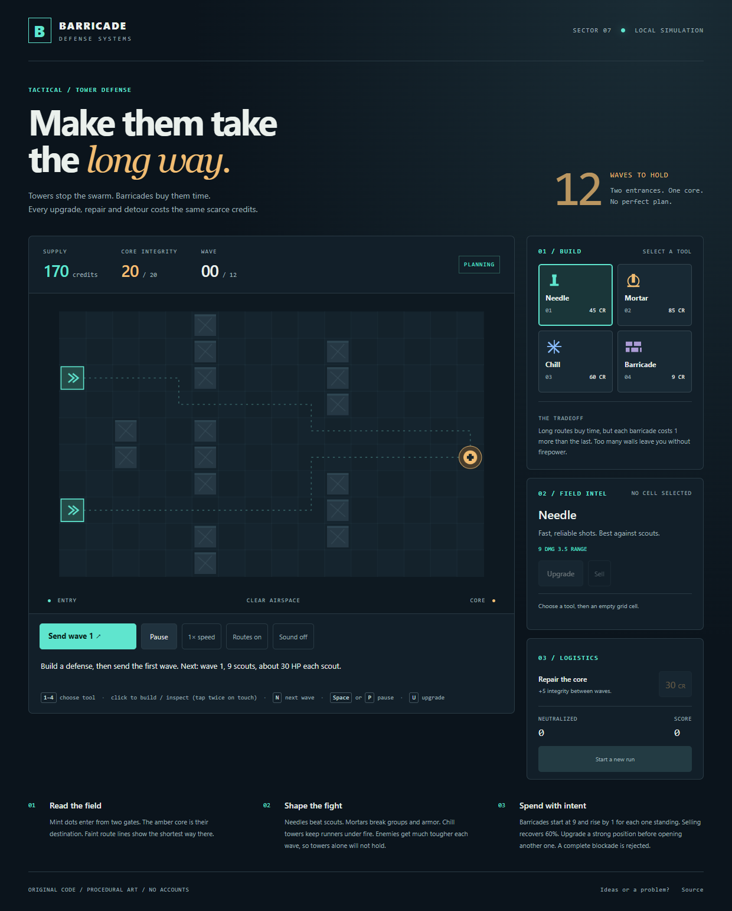

# Barricade Defense

A tactical tower defense game for the browser. Enemies come through two gates and head for one core. Towers, barricades, upgrades and core repairs all draw on the same small credit supply, so every wave asks where your next credit does the most good.

No accounts, packages, network requests or tracking. Plain JavaScript modules, HTML and CSS, with procedural canvas art and optional generated sound.



## Play

Requires Python 3.11 or newer.

```sh
python serve.py              # then open http://127.0.0.1:8792/
python serve.py --port 9000
```

On Windows you can double-click `Start-Game.cmd`.

| Action          | Mouse / touch                        | Keyboard                  |
|-----------------|--------------------------------------|---------------------------|
| Choose a tool   | Tool buttons                         | 1 to 4                    |
| Build / inspect | Click a cell (touch: tap twice)      | Arrow keys, then Enter    |
| Send next wave  | Send wave button                     | N                         |
| Pause           | Pause button                         | Space or P                |
| Upgrade         | Upgrade button                       | U                         |

`?seed=123` replays a run with the same enemy variation.

## Rules

- **Towers**: Needle (45, fast single shots), Mortar (85, splash damage that ignores armor), Chill (60, slows). Each upgrades twice for more damage, range and fire rate.
- **Barricades** start at 9 credits and cost 1 more for each one standing. They reroute enemies but can never close the last path from either gate, or cut off an enemy already on the board. Barricades lock in place while a wave is live, and you can sell them between waves.
- **Selling** returns 60% of what you invested. **Repair** restores 5 core integrity for 30 credits between waves.
- Enemies get about 15% tougher each wave on top of a linear increase. Armored enemies take half damage from Needles and Chill, and each one that reaches the core costs 3 integrity.
- Hold all 12 waves to win. Remaining core integrity adds to your score.

## Balance

`tools/balance.js` runs deterministic strategy bots through the real game rules:

```sh
node tools/balance.js 12
```

With the shipped settings (12 seeds): building nothing loses on wave 2, towers alone fall around wave 10, repairs stretch that to about wave 11, a wall-heavy maze wins only some runs, and a mix of route shaping, towers and upgrades wins every run. Random placement usually loses partway through. Tuning lives in `BALANCE` in `src/game.js`.

## Tests

```sh
node --test "tests/*.test.js"                         # engine rules, balance, fuzzing, key guards
python -m unittest discover -s tests -p "test_*.py"   # raw-socket server tests
```

## Layout

```
index.html, styles.css, favicon.svg
src/game.js     deterministic simulation (flow field, towers, waves, economy)
src/app.js      canvas renderer, input, HUD, fixed-step loop with interpolation
src/terrain.js  static terrain layer, rebuilt on resize or restart
src/preview.js  unchanged planning previews reused; live enemies rechecked
src/keys.js     keyboard guards
serve.py        loopback-only static server
tests/          Node and Python tests
tools/          strategy bots and balance report
```

## Privacy and security

See [SECURITY.md](SECURITY.md). Feedback and ideas: [central feedback form](https://github.com/Jgolding1998/Jgolding1998/issues/new?template=feedback.yml).

## License

MIT, see [LICENSE](LICENSE).
